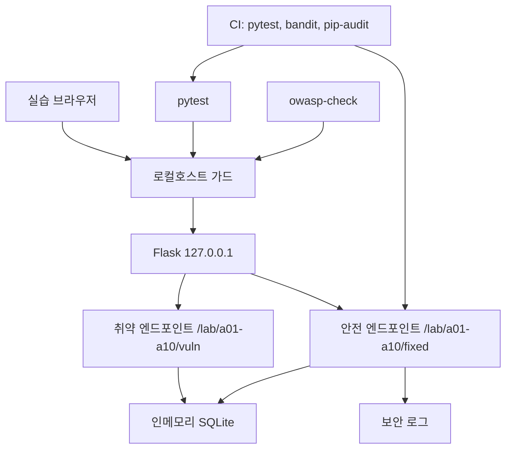
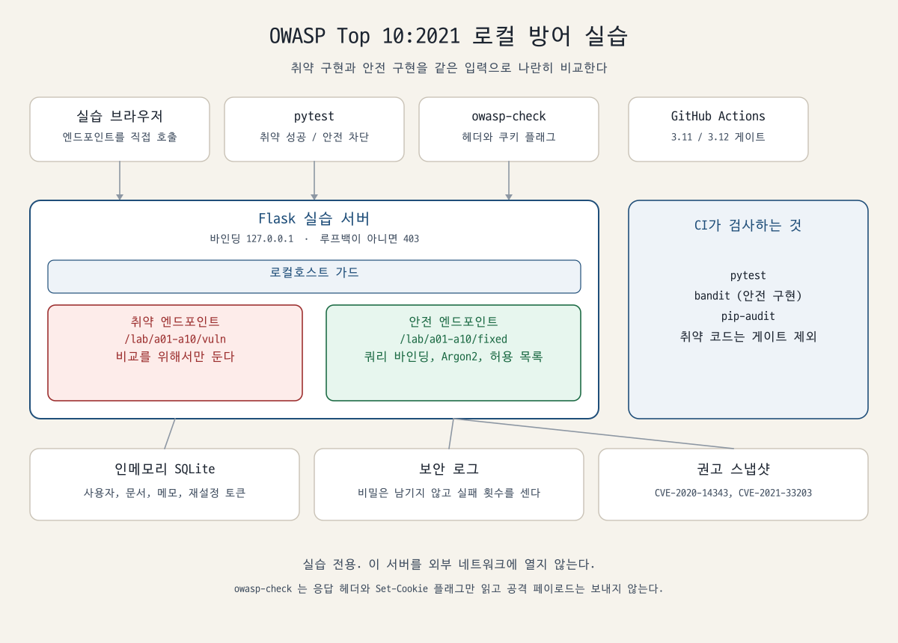
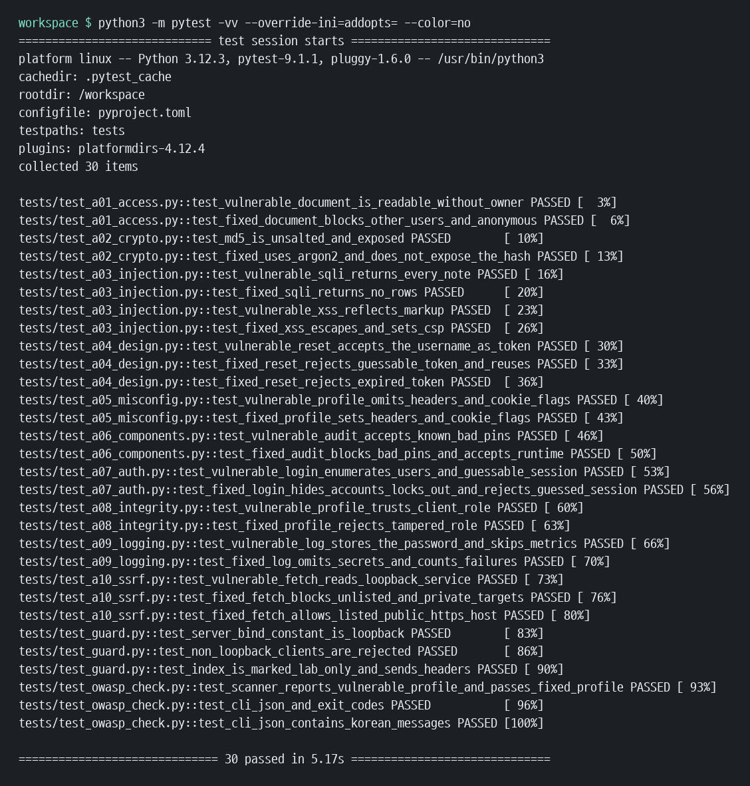
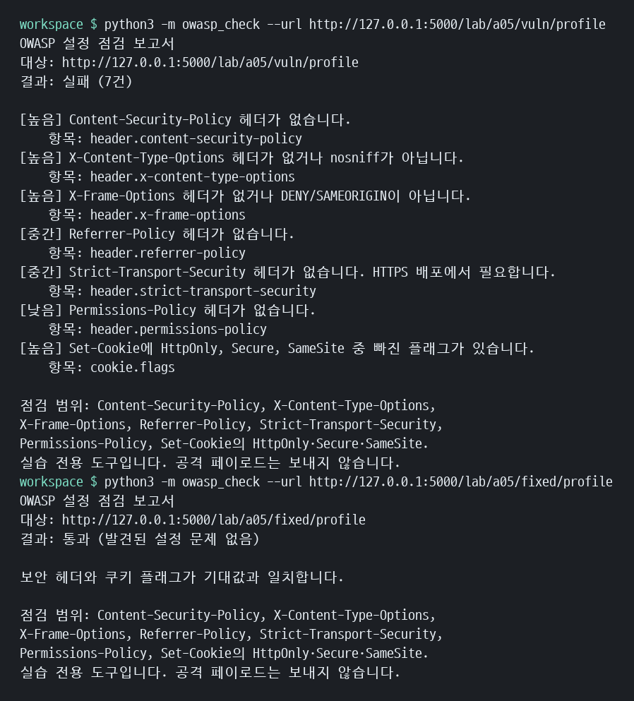

# OWASP Top 10:2021 로컬 방어 실습

로컬호스트에서만 동작하는 Flask 실습이다. 항목마다 **취약 엔드포인트**와 **안전 엔드포인트**를 나란히 두고, 같은 입력으로 한쪽은 공격이 통과하고 다른 쪽은 막히는 것을 pytest로 고정한다.

이 서버는 교육용이다. `127.0.0.1` 이외에는 바인딩하지 않으며, 루프백이 아닌 클라이언트는 403을 받는다. 외부에 공개하지 말 것.

기준 목록은 [OWASP Top 10:2021](https://owasp.org/Top10/2021/)이다. 2025년 판의 순위 변경은 아래 「2025에서 확인된 변화」에만 적었다.

## 아키텍처

브라우저, pytest, `owasp-check`가 같은 Flask 프로세스에 요청을 보낸다. 프로세스는 루프백 가드를 통과한 뒤 취약 구현 또는 안전 구현으로 갈라지고, 둘 다 같은 인메모리 SQLite를 본다. CI는 안전 구현과 점검기를 `pytest`, `bandit`, `pip-audit`로 검사한다.



한글이 글꼴에 의존하지 않도록 경로로 그린 그림이다.



## 실행

Python 3.11 또는 3.12.

```bash
python -m venv .venv
source .venv/bin/activate
pip install -r requirements.txt -r requirements-dev.txt
pytest
python -m app
```

서버는 `http://127.0.0.1:5000` 에서만 수신한다. 실습 계정은 `alice` / `alice-lab-pass`, `bob` / `bob-lab-pass` 이다. 문서 1은 alice, 문서 2는 bob 소유다.

설정 점검:

```bash
owasp-check --url http://127.0.0.1:5000/lab/a05/vuln/profile
owasp-check --url http://127.0.0.1:5000/lab/a05/fixed/profile
owasp-check --url http://127.0.0.1:5000/ --json
```

패키지를 설치하지 않았다면 `python -m owasp_check` 로 같은 진입점을 호출한다. 기본 URL은 `http://127.0.0.1:5000/` 이다.

## 엔드포인트

| 항목 | 취약 | 안전 |
| --- | --- | --- |
| A01 접근 제어 | `GET /lab/a01/vuln/documents/<id>` | `GET /lab/a01/fixed/documents/<id>` |
| A02 암호 실패 | `POST /lab/a02/vuln/login` | `POST /lab/a02/fixed/login` |
| A03 인젝션 | `GET /lab/a03/vuln/notes`, `POST /lab/a03/vuln/echo` | `GET /lab/a03/fixed/notes`, `POST /lab/a03/fixed/echo` |
| A04 안전하지 않은 설계 | `POST /lab/a04/vuln/reset` | `POST /lab/a04/fixed/reset` |
| A05 보안 설정 오류 | `GET /lab/a05/vuln/profile` | `GET /lab/a05/fixed/profile` |
| A06 취약한 구성요소 | `GET /lab/a06/vuln/audit?manifest=demo` | `GET /lab/a06/fixed/audit?manifest=demo` |
| A07 식별·인증 실패 | `POST /lab/a07/vuln/login` | `POST /lab/a07/fixed/login` |
| A08 무결성 실패 | `POST /lab/a08/vuln/profile` | `POST /lab/a08/fixed/profile` |
| A09 로깅·모니터링 실패 | `POST /lab/a09/vuln/login` | `POST /lab/a09/fixed/login` |
| A10 SSRF | `POST /lab/a10/vuln/fetch` | `POST /lab/a10/fixed/fetch` |

A01 안전 경로는 `POST /lab/a01/login` 으로 세션을 만든 뒤에만 자기 문서를 반환한다.

## A01 Broken Access Control

### 개요

인증된 사용자라도 다른 사용자의 객체에 접근하면 안 된다. 이 실습의 실패 형태는 IDOR이다. 문서 번호만 알면 소유자와 무관하게 본문이 나간다.

### 위험

다른 계정의 메모, 주문, 첨부 파일이 노출된다. 응답으로 존재 여부까지 알려 주면 식별자도 추측 대상이 된다.

### 공격 예시

로그인 없이 `GET /lab/a01/vuln/documents/2` 를 호출하면 bob의 메모 `bob-only-memo` 가 반환된다.

### 대응

세션의 `user_id`와 `documents.owner_id`가 같을 때만 반환한다. 인증이 없으면 401, 소유자가 아니면 404로 존재 여부를 숨긴다.

### 코드 diff

```diff
- def read_document(conn, doc_id):
-     row = document_by_id(conn, doc_id)
-     if row is None:
-         return None
-     return {"id": row["id"], "title": row["title"], "body": row["body"]}
+ def read_document(conn, doc_id, user_id):
+     if user_id is None:
+         raise AuthRequired
+     row = document_by_id(conn, doc_id)
+     if row is None or row["owner_id"] != user_id:
+         return None
+     return {"id": row["id"], "title": row["title"], "body": row["body"]}
```

## A02 Cryptographic Failures

### 개요

비밀번호를 솔트 없는 MD5로 저장하고 응답에 해시까지 돌려준다. 같은 비밀번호는 항상 같은 다이제스트가 된다.

### 위험

유출된 MD5는 사전 계산으로 바로 복원된다. 해시가 응답에 실리면 저장소가 털리기 전에도 오프라인 추측이 가능하다.

### 공격 예시

`GET /lab/a02/vuln/stored/alice` 는 `md5("alice-lab-pass")` 와 같은 32자리 헥스를 반환한다. 그 값으로 `POST /lab/a02/vuln/login` 이 성공한다.

### 대응

비밀번호는 Argon2id(`argon2-cffi`의 `PasswordHasher`)로만 검증한다. 안전 엔드포인트는 해시 문자열을 응답에 넣지 않고 알고리즘 이름만 알린다. 같은 비밀번호를 두 번 해시하면 솔트 때문에 결과가 달라진다.

### 코드 diff

```diff
- def weak_md5(value: str) -> str:
-     return hashlib.md5(value.encode("utf-8")).hexdigest()
+ def verify_password(stored_hash: str, candidate: str) -> bool:
+     hasher = PasswordHasher()
+     try:
+         return hasher.verify(stored_hash, candidate)
+     except (VerifyMismatchError, VerificationError, InvalidHashError):
+         return False
```

## A03 Injection

### 개요

항목 안에 SQL 인젝션과 반사 XSS를 모두 둔다. 취약 경로는 입력을 쿼리 문자열과 HTML에 그대로 잇는다.

### 위험

SQL 인젝션은 다른 행의 비밀 메모를 읽고, XSS는 브라우저에서 그 페이지의 스크립트로 해석될 수 있다.

### 공격 예시

`GET /lab/a03/vuln/notes?id=1 OR 1=1` 은 메모 두 건을 모두 반환하고, 그 안에 `bob-secret-note` 가 있다.

`POST /lab/a03/vuln/echo` 에 `{"text": "<script>alert(1)</script>"}` 를 보내면 응답 HTML에 태그가 그대로 남고 CSP도 없다.

### 대응

숫자의 형태가 아니면 빈 결과를 주고, 조회는 `?` 자리표시자로만 한다. HTML은 `html.escape`로 바꾸고, 안전 응답에는 `script-src 'none'` 을 포함한 Content-Security-Policy를 붙인다.

### 코드 diff

```diff
- query = f"SELECT id, title, body FROM notes WHERE id = {raw_id}"
- rows = conn.execute(query).fetchall()
+ if not raw_id.isdigit():
+     return []
+ rows = conn.execute(
+     "SELECT id, title, body FROM notes WHERE id = ?",
+     (int(raw_id),),
+ ).fetchall()
```

```diff
- f"<div id=\"echo\">{text}</div>"
+ safe = html.escape(text, quote=True)
+ f"<div id=\"echo\">{safe}</div>"
```

## A04 Insecure Design

### 개요

비밀번호 재설정 토큰을 사용자 이름으로 발급한다. 암호학 프리미티브의 문제가 아니라, 위협 모델링 없이 만든 절차의 문제다.

### 위험

계정 이름만 알면 재설정이 끝난다. 토큰이 응답 본문에 예측 가능한 값으로 실리고, 만료와 1회 사용도 없다.

### 공격 예시

`POST /lab/a04/vuln/reset` 에 `{"username": "alice"}` 를 보내면 `token` 이 `alice` 다. 그 값으로 `POST /lab/a04/vuln/confirm` 을 호출하면 비밀번호가 바뀐다.

### 대응

`secrets.token_urlsafe(32)` 로 발급하고 SHA-256만 저장한다. 만료 시각이 지나면 거절하고, 사용한 토큰은 `used` 로 표시한다. 발급 응답에는 토큰을 넣지 않는다. 실습에서는 로그인 사용자의 받은편지함이 메일함을 대신하며, 다른 사용자는 그 값을 읽을 수 없다. 사용자 존재 여부와 관계없이 발급 응답 모양은 같다.

### 코드 diff

```diff
- def issue_token(username: str) -> str:
-     return username
+ def issue_token() -> str:
+     return secrets.token_urlsafe(32)
+
+ def consume_token(conn, username, token, *, now=None) -> bool:
+     # 만료 전·미사용 행의 SHA-256과 compare_digest 로 비교하고 used=1
```

## A05 Security Misconfiguration

### 개요

취약 프로필은 보안 헤더가 없고, `Set-Cookie: prefs=open` 처럼 플래그가 빠진 쿠키를 심으며, 예외 본문에 스택 추적을 넣는다.

### 위험

클릭재킹, MIME 혼동, 리퍼러 유출, 스크립트가 읽는 쿠키, 경로와 내부 예외가 드러난다. 개발 서버의 디버그 페이지를 그대로 두면 구성 자체가 취약점이 된다.

### 공격 예시

`GET /lab/a05/vuln/profile` 응답에는 CSP, `X-Content-Type-Options`, `X-Frame-Options`, `Referrer-Policy`, HSTS, `Permissions-Policy` 가 없다. 쿠키 문자열에도 `HttpOnly`, `Secure`, `SameSite` 가 없다.

`GET /lab/a05/vuln/debug` 는 500 본문에 `ZeroDivisionError` 스택을 그대로 쓴다.

### 대응

안전 프로필은 위 헤더를 모두 넣고 쿠키를 `HttpOnly; Secure; SameSite=Strict` 로 설정한다. 예외는 `요청을 처리할 수 없습니다.` 만 반환한다. HSTS는 HTTPS로 서비스할 때 효력이 있으며, 헤더 자체는 안전 구성에 포함해 점검기가 빠짐없이 확인하게 했다.

### 코드 diff

```diff
- response.headers["Set-Cookie"] = "prefs=open"
- return traceback.format_exc(), 500
+ response.headers["Set-Cookie"] = "prefs=open; HttpOnly; Secure; SameSite=Strict"
+ apply_security_headers(response)
+ return {"error": "요청을 처리할 수 없습니다."}, 500
```

## A06 Vulnerable and Outdated Components

### 개요

취약 경로는 알려진 나쁜 핀이 있어도 200을 반환한다. 안전 경로는 같은 목록을 권고 스냅샷과 비교해 409로 거부한다. 이 목록은 설치하지 않는다. `fixtures/demo-vulnerable-requirements.txt` 는 감사 표본일 뿐이다.

표본의 식별자는 `pip-audit`로 확인했다.

- `pyyaml==5.3.1` → CVE-2020-14343 (수정 5.4)
- `django==1.11.29` → CVE-2021-33203

런타임 의존성 `Flask==3.1.3`, `argon2-cffi==25.1.0` 은 CI에서 `pip-audit -r requirements.txt` 로 다시 감사한다.

### 위험

직접 코드를 짜지 않아도 오래된 라이브러리의 공개 결함이 프로세스 권한이 된다. 빌드가 취약 핀을 거부하지 않으면 수정 버전이 있어도 배포에 남는다.

### 공격 예시

`GET /lab/a06/vuln/audit?manifest=demo` 는 `enforced: false` 와 함께 CVE-2020-14343, CVE-2021-33203 을 담아 200을 준다. 즉 알고도 통과시킨다.

### 대응

안전 경로는 같은 핀이 있으면 409와 `blocked: true` 를 반환한다. `manifest=runtime` 은 현재 `requirements.txt` 를 보고 200을 준다. 라이브 감사는 GitHub Actions의 `pip-audit`가 담당한다.

### 코드 diff

```diff
- return {"enforced": False, "findings": find_advisories(text)}
+ findings = find_advisories(text)
+ return {"enforced": True, "findings": findings, "blocked": bool(findings)}
```

안전 라우트는 `blocked` 이면 HTTP 409다.

## A07 Identification and Authentication Failures

### 개요

취약 로그인은 없는 계정과 틀린 비밀번호의 문장을 다르게 반환하고, 실패 횟수와 무관하게 계속 시도할 수 있다. 세션 쿠키 값은 사용자 번호 그대로다.

### 위험

계정 열거, 무제한 추측, `session_id=2` 처럼 만든 쿠키로 다른 사용자 행세를 할 수 있다.

### 공격 예시

없는 계정은 `사용자를 찾을 수 없습니다.`, 틀린 비밀번호는 `비밀번호가 올바르지 않습니다.` 를 받는다. 여섯 번 틀려도 401이다. 쿠키 `session_id=2` 로 `GET /lab/a07/vuln/me` 를 호출하면 `bob` 이 반환된다.

### 대응

실패 문장은 `아이디 또는 비밀번호가 올바르지 않습니다.` 로 통일한다. 임계 횟수 이후에는 429로 잠근다. 세션 값은 `secrets.token_urlsafe(32)` 이고 서버 맵에만 사용자 번호를 둔다. 쿠키에는 `HttpOnly`, `Secure`, `SameSite=Strict` 를 붙인다. 비밀번호 검증 자체는 Argon2id다.

### 코드 diff

```diff
- def failure_message(*, user_exists: bool) -> str:
-     return BAD_PASSWORD if user_exists else UNKNOWN
- def session_cookie_value(user_id: int) -> str:
-     return str(user_id)
+ def failure_message() -> str:
+     return "아이디 또는 비밀번호가 올바르지 않습니다."
+ def new_session_id() -> str:
+     return secrets.token_urlsafe(32)
```

## A08 Software and Data Integrity Failures

### 개요

취약 경로는 클라이언트가 보낸 `role` 을 서명 없이 수용한다. 안전 경로는 서버가 발급한 HMAC만 믿는다.

### 위험

프로필이나 업데이트 페이로드의 역할을 클라이언트가 바꾸면 권한 경계가 사라진다. 무결성 검증이 없는 데이터는 공급망보다 한 단계 아래의 신뢰 경계 실패다.

### 공격 예시

`POST /lab/a08/vuln/profile` 에 `{"username": "alice", "role": "admin"}` 을 보내면 역할이 `admin` 으로 저장된다. `verified` 는 false다.

### 대응

`POST /lab/a08/fixed/issue` 는 역할을 `user` 로 고정하고 `username|role` 의 HMAC-SHA256을 붙인다. 안전 프로필 엔드포인트는 `hmac.compare_digest` 가 성공할 때만 수용한다. 역할만 `admin` 으로 바꾸면 403이다.

### 코드 diff

```diff
- def accept_profile(payload: dict) -> dict:
-     return {"username": payload.get("username", ""), "role": payload.get("role", "user"), "verified": False}
+ def accept_profile(secret: bytes, payload: dict) -> dict | None:
+     expected = sign(secret, username, role)
+     if not hmac.compare_digest(expected, signature):
+         return None
+     return {"username": username, "role": role, "verified": True}
```

## A09 Security Logging and Monitoring Failures

### 개요

취약 로그인은 실패한 비밀번호를 이벤트에 그대로 남기고, 실패 횟수 카운터는 올리지 않는다.

### 위험

로그 저장소가 두 번째 비밀번호 저장소가 된다. 카운터가 없으면 반복 실패를 경보로 바꿀 근거가 없다.

### 공격 예시

틀린 비밀번호로 `POST /lab/a09/vuln/login` 을 호출한 뒤 `GET /lab/a09/vuln/events` 를 보면 `password` 필드에 그 문자열이 있고 `auth_failure` 는 0이다.

### 대응

안전 이벤트는 `auth_failure` 또는 `auth_success`, 사용자 이름, `request_id` 만 가진다. 실패할 때마다 `auth_failure` 카운터가 증가한다. 응답과 로그 어디에도 비밀번호 문자열이 없다.

### 코드 diff

```diff
- log.append({"event": "login", "username": username, "password": password, "success": success})
+ event = {
+     "event": "auth_success" if success else "auth_failure",
+     "username": username,
+     "request_id": uuid.uuid4().hex[:12],
+ }
+ if not success:
+     metrics["auth_failure"] += 1
```

## A10 Server-Side Request Forgery

### 개요

취약 경로는 호출자가 준 `http`/`https` URL을 서버가 대신 가져온다. `file` 스킴은 실습 범위를 벗어나므로 양쪽 모두 거절하고, 취약 경로도 타임아웃 2초와 본문 4KB로만 제한한다.

### 위험

서버가 볼 수 있는 주소는 브라우저가 볼 수 있는 주소와 다르다. 루프백이나 링크로컬로 내부 응답을 읽을 수 있다.

### 공격 예시

테스트는 루프백에 표식 서버를 띄우고 `POST /lab/a10/vuln/fetch` 에 그 URL을 넘긴다. 취약 경로는 본문의 `INTERNAL-LAB-MARKER` 를 그대로 반환한다.

### 대응

안전 경로는 호스트가 `books.example` 이고 스킴이 `https` 이며 포트가 443일 때만 진행한다. DNS 결과가 공인 주소가 아니면 연결하지 않고, 리다이렉트는 따라가지 않는다. 루프백 URL과 `http://169.254.169.254/latest` 는 연결 전에 403이다.

### 코드 diff

```diff
- with open_url(url, timeout=2) as response:
-     payload = response.read(4096)
+ if parsed.scheme != "https" or host not in ALLOWED_HOSTS:
+     raise FetchBlocked("허용 목록에 없는 대상입니다.")
+ for raw in addresses:
+     if not ipaddress.ip_address(raw).is_global:
+         raise FetchBlocked("공인 주소만 허용됩니다.")
```

## owasp-check

`owasp-check` 는 대상 URL에 GET 한 번을 보내고 응답 헤더와 `Set-Cookie` 만 본다. 공격 문자열은 보내지 않고 리다이렉트도 따라가지 않는다.

실패로 보는 항목:

| 심각도 | 조건 |
| --- | --- |
| 높음 | CSP 없음, `X-Content-Type-Options` 가 `nosniff` 가 아님, `X-Frame-Options` 가 `DENY`/`SAMEORIGIN` 이 아님, 쿠키에 `HttpOnly`·`Secure`·`SameSite` 중 하나라도 없음 |
| 중간 | `Referrer-Policy` 없음, HSTS에 `max-age` 없음 |
| 낮음 | `Permissions-Policy` 없음 |

종료 코드는 통과 0, 발견 1, 연결 실패 2다. `--json` 이면 한국어 메시지와 함께 기계가 읽을 수 있는 객체를 낸다.

```json
{
  "target": "http://127.0.0.1:5000/lab/a05/vuln/profile",
  "ok": false,
  "finding_count": 7,
  "findings": [
    {
      "check_id": "header.content-security-policy",
      "severity": "high",
      "message": "Content-Security-Policy 헤더가 없습니다."
    }
  ]
}
```

## 테스트와 CI

`pytest` 는 취약 경로에서 공격이 통과하는 것과 안전 경로에서 막히는 것을 각 항목마다 확인한다. `.github/workflows/ci.yml` 은 Python 3.11과 3.12에서 다음을 순서대로 실행한다.

1. `pytest`
2. `bandit -c bandit.yaml -r app owasp_check`
3. `pip-audit -r requirements.txt`

`bandit` 게이트는 안전 구현, 앱 골격, `owasp_check` 만 본다. `app/vulnerable` 은 의도된 실습 코드라 `bandit.yaml` 에서 제외했다. 제외는 취약점을 숨기는 용도가 아니라, 비교용 코드 때문에 안전 구현의 검사가 실패하지 않게 하려는 것이다.

## 스크린샷

아래 이미지는 이 저장소에서 실행한 터미널 출력을 D2Coding으로 렌더링한 것이다. 창 테두리는 넣지 않았고, 명령 행부터 결과의 마지막 줄까지 잘리지 않게 두었다.





## 2025에서 확인된 변화

실습 번호는 2021을 유지한다. 아래는 [OWASP Top 10:2025 소개](https://owasp.org/Top10/2025/0x00_2025-Introduction/)에서 확인한 내용만 옮긴 것이다.

| 2025 | 이름 | 2021과의 관계 |
| --- | --- | --- |
| A01 | Broken Access Control | 1위 유지. SSRF(CWE-918)가 이 항목으로 들어왔다. |
| A02 | Security Misconfiguration | 2021의 5위에서 2위로 올라왔다. |
| A03 | Software Supply Chain Failures | 2021 A06 취약한 구성요소를 의존성, 빌드, 배포까지 넓힌 항목이다. |
| A04 | Cryptographic Failures | 2위에서 4위. |
| A05 | Injection | 3위에서 5위. XSS와 SQL 인젝션을 함께 다룬다. |
| A06 | Insecure Design | 4위에서 6위. |
| A07 | Authentication Failures | 자리는 7위. 이름에서 Identification이 빠졌다. |
| A08 | Software or Data Integrity Failures | 8위 유지. |
| A09 | Security Logging and Alerting Failures | 9위. 모니터링 대신 경보를 이름에 넣었다. |
| A10 | Mishandling of Exceptional Conditions | 새 항목. 2021의 A10 SSRF는 A01로 합쳐졌다. |

소개 페이지가 적은 수치도 그대로 두면, A01은 시험한 애플리케이션의 3.73%가 이 범주 40개 CWE 중 하나 이상을 가졌고, 보안 설정 오류는 3.00%가 16개 CWE 중 하나 이상을 가졌다.

## 라이선스

MIT. `LICENSE` 를 본다.
